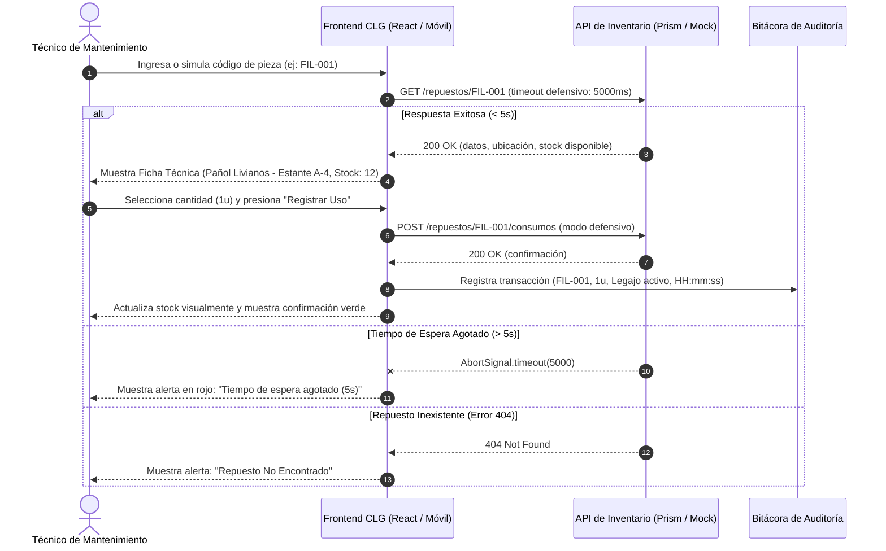

# CU-01: Consulta y Egreso de Repuestos para Reparación Técnica

| Atributo | Detalle |
| :--- | :--- |
| **Identificador** | CU-01 |
| **Nombre** | Consulta y Egreso de Repuestos para Reparación Técnica |
| **Estado** | Implementado (Fase 1) |
| **Actor Principal** | Técnico de Mantenimiento |
| **Actores Secundarios** | Servidor Mock / API OpenAPI (Prism) |

---

## 1. Propósito y Descripción
Permitir al personal de mantenimiento verificar la disponibilidad y ubicación física exacta de una pieza crítica e imputar su retiro a la orden activa, previniendo quiebres y garantizando trazabilidad física y documental bajo normas sanitarias GMP.

---

## 2. Precondiciones y Poscondiciones

### Precondiciones
* El técnico dispone de una sesión activa seleccionada en la cabecera del sistema.
* El dispositivo móvil o estación de trabajo cuenta con conectividad a la aplicación web.

### Poscondiciones
* El stock disponible del repuesto se actualiza en la interfaz de usuario.
* Se genera un registro inmutable en la bitácora de auditoría con código de pieza, cantidad retirada, legajo del técnico y marca temporal en formato militar (24 hs).

---

## 3. Flujo Principal (Escenario de Éxito)

1. El técnico accede a la pestaña **Repuestos (CU-01)** o presiona el botón **Abrir Escáner de Pieza →** desde la consola de inicio.
2. El sistema despliega el campo de búsqueda asistida junto con el catálogo de códigos de prueba en pantalla (`FIL-001`, `MOT-005`, `PLA-104`).
3. El técnico ingresa o simula el escaneo del código de la pieza y presiona **Consultar** (o la tecla `Enter`).
4. El sistema emite una petición asíncrona validada contractualmente con un límite de espera defensivo de 5 segundos (`AbortSignal.timeout(5000)`).
5. La API confirma la existencia de la pieza y devuelve los metadatos de inventario.
6. El sistema renderiza la ficha técnica (`RepuestoCard`) detallando:
   * Código y denominación estandarizada del repuesto.
   * Sector físico asignado (*Pañol Livianos - Estante A-4*, *Depósito Pesados - Rack B-12* o *Pañol Instrumentación - Gaveta E-02*).
   * Unidades disponibles y distintivo de estado de stock (Óptimo o Stock Bajo).
7. El técnico define la cantidad a retirar (por defecto 1 unidad).
8. El técnico confirma la acción presionando **Registrar Uso de Repuesto**.
9. El sistema descuenta las unidades de la disponibilidad en pantalla, añade la transacción al historial de auditoría con la firma del legajo en sesión y muestra un mensaje de confirmación en verde.

---

## 4. Flujos Alternativos y Excepciones

* **FA-01 (Código Inexistente en Inventario):** En el paso 4, si el código ingresado no coincide con ningún registro del catálogo, el sistema oculta la ficha técnica y despliega una tarjeta de advertencia visual en rojo informando: *⚠️ Repuesto No Encontrado: La pieza solicitada no figura en el catálogo activo de planta*. La interfaz permanece interactiva para nuevos intentos.
* **FA-02 (Agotamiento del Límite de Espera - Timeout Defensivo):** En el paso 4, si la red local se degrada o el servidor no responde dentro de los 5 segundos, la petición se cancela de forma controlada y el sistema despliega el mensaje: *Tiempo de espera agotado (5s). El servidor de inventario no responde*.
* **FA-03 (Tolerancia a Caídas de Red / Modo Offline Simulado):** En el paso 8, si se pierde el enlace con la API al momento de confirmar el egreso, la aplicación captura el error mediante bloques defensivos (`try/catch`), descuenta el stock en el estado local de la sesión, registra la auditoría y documenta una advertencia de contingencia en la consola sin interrumpir la operación del técnico.
* **FA-04 (Bloqueo por Stock Insuficiente):** En el paso 7, si el stock actual es 0 o la cantidad requerida supera las unidades físicas disponibles, el botón de egreso se deshabilita automáticamente impidiendo transacciones con saldos negativos.

---

## 5. Diagrama de Secuencia

