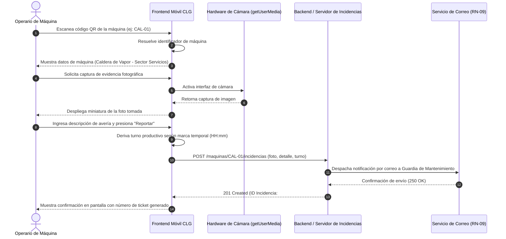

# CU-02: Reportar Incidencia con QR

| Atributo | Detalle |
| :--- | :--- |
| **Identificador** | CU-02 |
| **Nombre** | Reportar Incidencia con QR |
| **Estado** | Especificado para Roadmap (Fase 2) |
| **Actor Principal** | Operario de Máquina |
| **Actores Secundarios** | Servidor de Notificaciones SMTP (Mantenimiento de Guardia) |

---

## 1. Propósito y Descripción
Notificar averías mecánicas o electromecánicas en tiempo real desde el pie de máquina, capturando evidencia fotográfica para acelerar la asignación de guardias técnicas y reducir los tiempos de parada (downtime).

---

## 2. Precondiciones y Poscondiciones

### Precondiciones
* Operario presente en el piso de planta frente al equipo averiado.
* El equipo cuenta con su código QR identificador fijado al chasis.

### Poscondiciones
* Se genera y persiste una nueva incidencia técnica en estado *Reportada*.
* La incidencia queda vinculada al turno productivo vigente derivado de la hora del sistema.
* Se emite una alerta automática por correo electrónico al personal de guardia (RN-09).

---

## 3. Flujo Principal (Escenario de Éxito)

1. El operario abre la aplicación móvil y selecciona la opción de reporte de fallas.
2. El operario escanea el código QR adherido al equipo (ej. caldera `CAL-01`, fraccionador `FRA-02` o cinta transportadora `BAN-05`).
3. El sistema resuelve el código, identifica unívocamente la máquina y muestra en pantalla su denominación formal, línea productiva y sector físico.
4. El operario activa la captura fotográfica a través de la interfaz de cámara del navegador (`getUserMedia` / `input capture`).
5. El operario toma una o más fotografías del daño mecánico visible y la interfaz muestra las vistas previas correspondientes.
6. El operario redacta una descripción breve de la anomalía observada y selecciona el nivel de criticidad preliminar.
7. El operario presiona el botón **Reportar Incidencia**.
8. El sistema toma la marca temporal (`Date.now()`), deduce automáticamente el turno operativo (Mañana: 06:00 a 14:00, Tarde: 14:00 a 22:00, Noche: 22:00 a 06:00) y registra la incidencia en estado *Reportada*.
9. El sistema emite la notificación formal por correo electrónico a la casilla de guardia de mantenimiento bajo la regla de negocio RN-09.
10. La interfaz muestra un acuse de recibo confirmando el número de ticket generado.

---

## 4. Flujos Alternativos y Excepciones

* **FA-01 (Falla de Lectura Óptica de QR):** En el paso 2, si la etiqueta QR está dañada o ilegible, el sistema permite ingresar manualmente el identificador alfanumérico de la máquina mediante teclado.
* **FA-02 (Cancelación de Captura Fotográfica):** En el paso 4, si el dispositivo no posee permisos de cámara o el operario omite la captura, el sistema permite enviar el reporte adjuntando únicamente la descripción textual en modo de contingencia.

---

## 5. Diagrama de Secuencia

