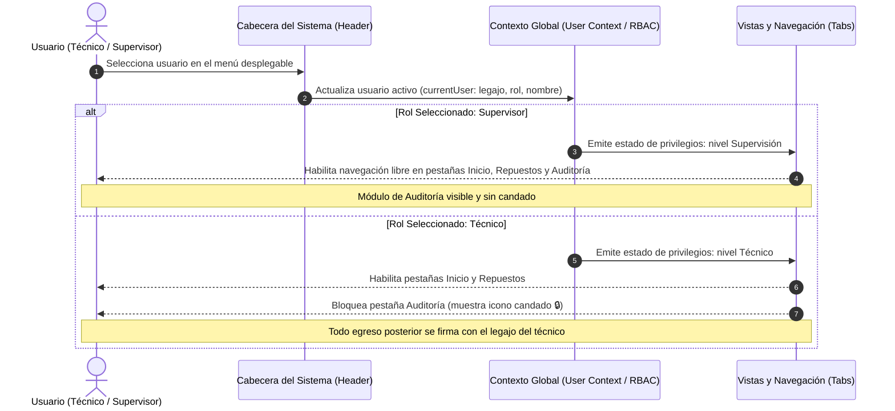

# CU-03: Control de Acceso y Gestión de Turno

| Atributo | Detalle |
| :--- | :--- |
| **Identificador** | CU-03 |
| **Nombre** | Control de Acceso y Gestión de Turno |
| **Estado** | Implementado (Fase 1) |
| **Actor Principal** | Técnico de Mantenimiento / Supervisor de Planta |
| **Actores Secundarios** | Capa de Presentación (Control RBAC) |

---

## 1. Propósito y Descripción
Gestionar la identidad activa del usuario para garantizar que cada transacción operativa quede firmada con nombre y legajo, adaptando de manera dinámica las pantallas y permisos según el rango asignado.

---

## 2. Precondiciones y Poscondiciones

### Precondiciones
* La aplicación web se encuentra cargada y accesible en el dispositivo.

### Poscondiciones
* Se actualiza el contexto global de usuario (`currentUser`).
* Los permisos de la interfaz (RBAC) se recalculan de forma inmediata, habilitando o bloqueando vistas restringidas.

---

## 3. Flujo Principal (Escenario de Éxito)

1. El usuario visualiza en la cabecera institucional el selector de personal activo.
2. El usuario despliega la lista y selecciona su perfil (ej. *Téc. Lucía Duran - Técnico* o *Ing. Cecilia Ballarre - Supervisor*).
3. El sistema actualiza el estado global de la sesión.
4. Si el perfil seleccionado corresponde al rol **Técnico**:
   * Se habilitan los módulos de consulta y egreso de piezas (CU-01).
   * La pestaña **Auditoría (RN-06)** se marca visualmente con un icono de candado cerrado (`🔒`) y su acceso queda restringido.
5. Si el perfil seleccionado corresponde al rol **Supervisor**:
   * Se habilitan los módulos operativos de planta.
   * Se remueve el bloqueo sobre la pestaña de auditoría, permitiendo la inspección completa de registros.
6. A partir de este momento, cualquier retiro de repuesto imputa automáticamente el nombre y legajo del perfil seleccionado.

---

## 4. Flujos Alternativos y Excepciones

* **FA-01 (Persistencia de Sesión Durante Navegación):** Al alternar entre las distintas pantallas de la barra de navegación (`Inicio`, `Repuestos`, `Auditoría`), el usuario activo se conserva intacto en la memoria del cliente sin requerir reelección.

---

## 5. Diagrama de Secuencia

