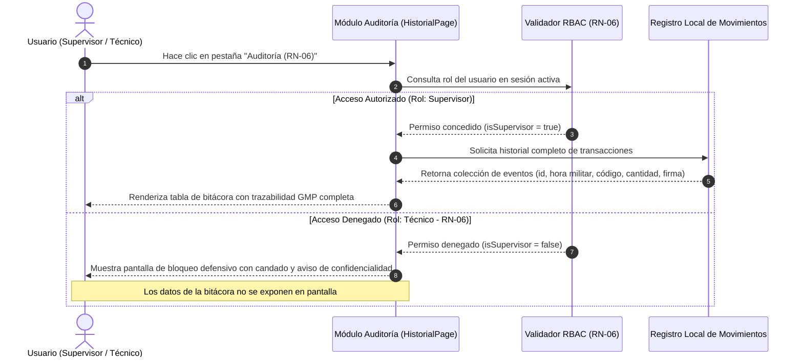

# CU-04: Auditoría y Trazabilidad de Consumos GMP

| Atributo | Detalle |
| :--- | :--- |
| **Identificador** | CU-04 |
| **Nombre** | Auditoría y Trazabilidad de Consumos GMP |
| **Estado** | Implementado (Fase 1) |
| **Actor Principal** | Supervisor de Planta |
| **Actores Secundarios** | Técnico de Mantenimiento (Actor con acceso restringido) |

---

## 1. Propósito y Descripción
Proporcionar una bitácora cronológica inmutable de todas las extracciones de repuestos efectuadas durante el turno, cumpliendo con las directrices de integridad de datos y auditoría de normas sanitarias GMP.

---

## 2. Precondiciones y Poscondiciones

### Precondiciones
* El usuario activo cuenta con rol de **Supervisor**.

### Poscondiciones
* El supervisor visualiza la totalidad de los eventos de egreso registrados sin alterar los registros existentes.

---

## 3. Flujo Principal (Escenario de Éxito)

1. El supervisor hace clic en la pestaña **Auditoría (RN-06)** de la barra de navegación superior o presiona **Ver Bitácora de Planta →** en la pantalla de Inicio.
2. El sistema valida los privilegios del perfil activo frente a la regla de negocio RN-06.
3. El sistema comprueba que el rol es de nivel supervisión y despliega la tabla histórica de auditoría.
4. El supervisor inspecciona las filas de la bitácora estructuradas con los siguientes campos:
   * **ID de Transacción:** Identificador único y correlativo del egreso.
   * **Hora (24 hs):** Marca de tiempo militar con precisión de segundos (`HH:mm:ss`).
   * **Código de Repuesto:** Código alfanumérico de la pieza retirada.
   * **Cantidad Consumida:** Volumen descontado del inventario.
   * **Operario / Firma:** Legajo y nombre completo del técnico responsable.
5. Los registros se presentan ordenados cronológicamente reflejando el orden de intervención en planta.

---

## 4. Flujos Alternativos y Excepciones

* **FA-01 (Intento de Acceso por Perfil Técnico - Regla RN-06):** En el paso 2, si un usuario con rol de **Técnico** intenta ingresar al módulo de auditoría, el sistema intercepta la navegación y renderiza una vista de bloqueo defensivo. La pantalla muestra un icono de candado centralizado junto con la advertencia: *Acceso Restringido: El registro histórico de movimientos y auditoría GMP está reservado exclusivamente para perfiles de Supervisión de Planta*. La bitácora de datos se mantiene oculta y protegida.

---

## 5. Diagrama de Secuencia

